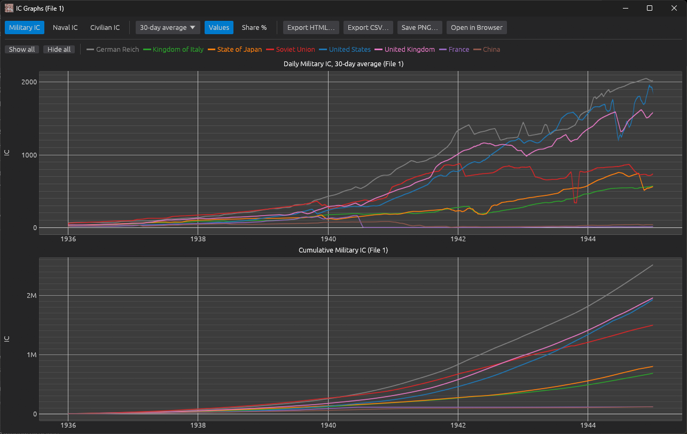
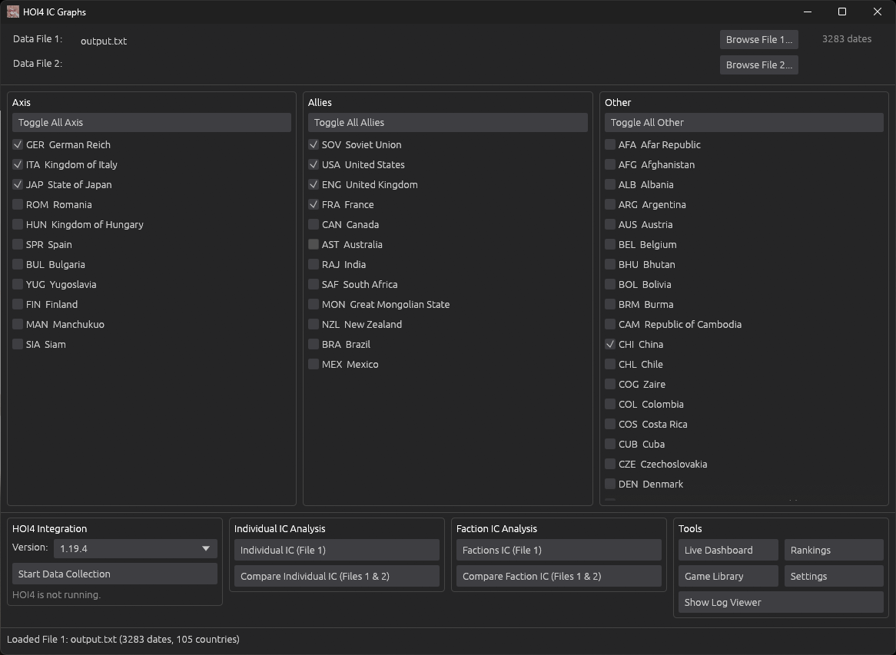
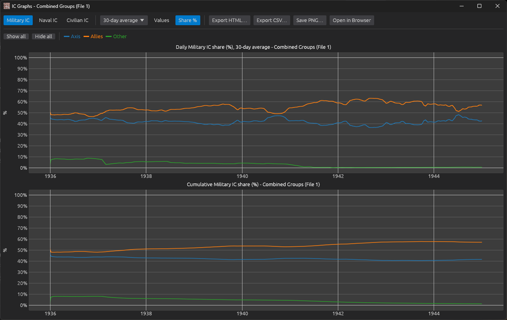
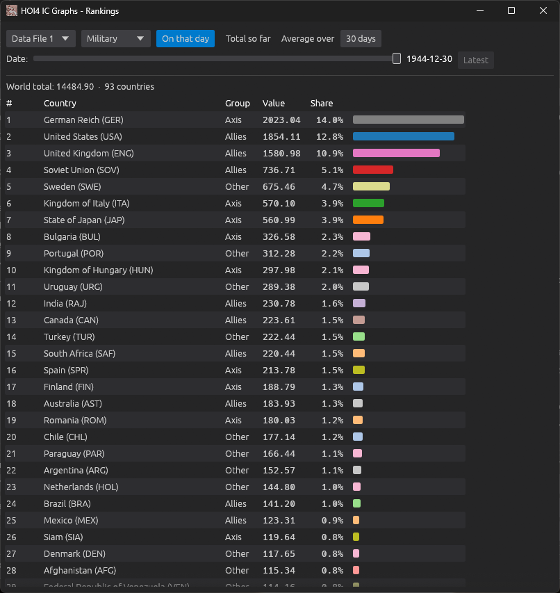
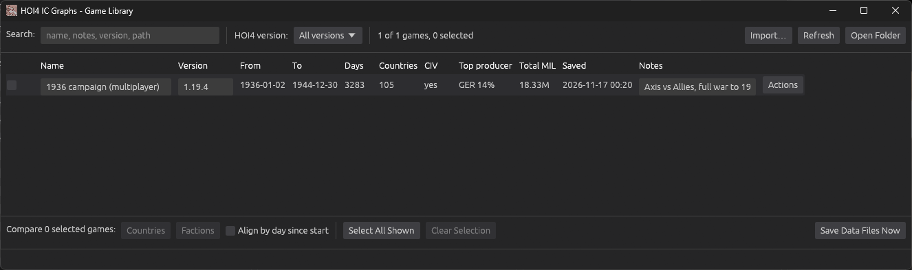
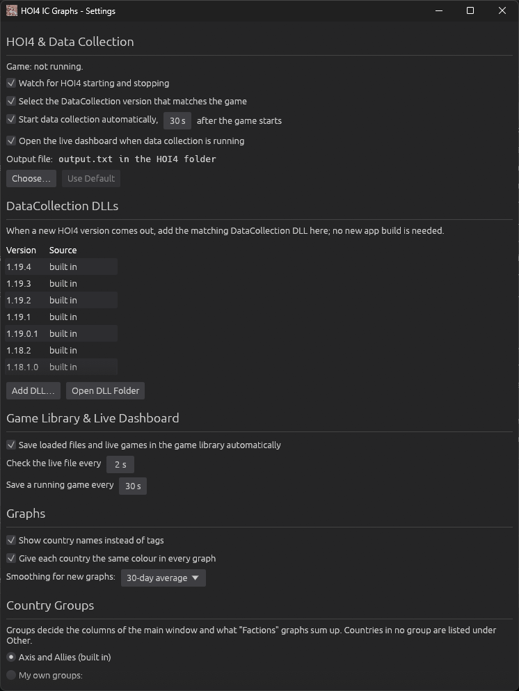

<div align="center">

# HOI4 IC Analyzer

**Record, chart and compare the industrial capacity of every country in your Hearts of Iron IV campaigns.**

[](https://github.com/zVSciy/Hoi4_IC_Graphs/actions/workflows/ci.yml)
[](https://github.com/zVSciy/Hoi4_IC_Graphs/releases/latest)
[](LICENSE)
[](#download)

**[Download](#download)** &nbsp;·&nbsp;
**[Quick start](#quick-start)** &nbsp;·&nbsp;
**[User guide](docs/USER_GUIDE.md)** &nbsp;·&nbsp;
**[Build from source](docs/BUILDING.md)**

</div>

<br>

<p align="center">
  
</p>

## Features

- **Fully automatic.** Start the app, start HOI4, play. Detection, data collection and the live dashboard start by themselves.
- **Graphs per country or faction.** Daily output and running totals for military, naval and civilian IC, with smoothing and share-of-total views.
- **Compare campaigns.** Put two files or any number of saved games side by side, optionally aligned by days since start.
- **Rankings.** Every country on any date, ordered by output, with its share of the world total.
- **Game library.** Every game is saved automatically, compressed and ready to reopen instantly.
- **Export.** Interactive HTML pages, CSV for spreadsheets, or PNG images.
- **Fast.** Written in Rust: the log of a full 1936–1945 campaign (43 MB) is parsed in about 20 ms.

## Download

Download `HOI4_Analyzer-<version>-windows-x64.zip` from the
**[Releases page](https://github.com/zVSciy/Hoi4_IC_Graphs/releases/latest)**, unzip it anywhere and
run `HOI4_Analyzer.exe`. No installation is needed.

- **System:** Windows 10 or 11, 64-bit
- **Game:** Hearts of Iron IV, any version with a matching DataCollection DLL

<details>
<summary><b>Verifying a download</b></summary>

<br>

Every release lists the SHA-256 checksum of each file in `SHA256SUMS.txt`. Compare it with:

```powershell
Get-FileHash .\HOI4_Analyzer-<version>-windows-x64.zip -Algorithm SHA256
```

</details>

> [!TIP]
> Antivirus programs sometimes flag tools that load a DLL into another process. The analyzer only
> loads the DataCollection DLL into `hoi4.exe`, and all of its source code is in this repository,
> so you can [build it yourself](docs/BUILDING.md).

## Quick start

1. **Unzip and start** `HOI4_Analyzer.exe`, and leave it open.
2. **Start Hearts of Iron IV and play.** The analyzer detects the game, starts data collection
   after it has loaded, opens the live dashboard and saves the game in the library.
3. **Look at the results.** Tick countries in the main window and click **Individual IC** or
   **Factions IC**, or open **Rankings** and the **Game Library**.

> [!IMPORTANT]
> **New HOI4 version?** Add the matching DataCollection DLL in
> **Settings → DataCollection DLLs → Add DLL…**. No new app download is needed.

Everything else is explained in the **[user guide](docs/USER_GUIDE.md)**.

## Screenshots

### Main window

Load one or two data files, tick the countries to chart, and open graphs, rankings, the live
dashboard or the game library.

<p align="center">
  
</p>

### Faction graphs

Each faction's share of world military IC over a whole campaign. Every graph also has a running
total and tabs for naval and civilian IC.

<p align="center">
  
</p>

### Rankings

Every country on any date, ordered by output, with its share of the world total.

<p align="center">
  
</p>

### Game library

Every game is saved automatically and can be reopened, compared, exported or shared.

<p align="center">
  
</p>

### Settings

Automatic data collection, DataCollection DLLs, the game library, graphs and country groups.

<p align="center">
  
</p>

## Building from source

You need [Rust](https://rustup.rs) and the Visual Studio C++ build tools. The Rust version is
pinned in `rust-toolchain.toml` and installed automatically.

```powershell
git clone https://github.com/zVSciy/Hoi4_IC_Graphs.git
cd Hoi4_IC_Graphs
cargo run --release
```

See **[docs/BUILDING.md](docs/BUILDING.md)** for prerequisites, feature flags, packaging and
troubleshooting.

## Contributing

Bug reports, ideas and pull requests are welcome.

| Document | What's in it |
| --- | --- |
| [CONTRIBUTING.md](CONTRIBUTING.md) | How to report bugs, suggest features and open a pull request |
| [docs/ARCHITECTURE.md](docs/ARCHITECTURE.md) | How the code is organised |
| [CODE_OF_CONDUCT.md](CODE_OF_CONDUCT.md) | How we treat each other |
| [SECURITY.md](SECURITY.md) | How to report a vulnerability privately |
| [CHANGELOG.md](CHANGELOG.md) | What changed in each release |

## License

The source code is released under the [MIT License](LICENSE). The prebuilt DataCollection DLLs in
[`DataCollection/`](DataCollection/) ship with the app so it can record data; their source code is
not part of this repository.

---

<sub>A fan-made tool, not affiliated with or endorsed by Paradox Interactive. Hearts of Iron IV is a
trademark of Paradox Interactive AB. Data collection loads a DLL into the running game; use it at
your own risk.</sub>
